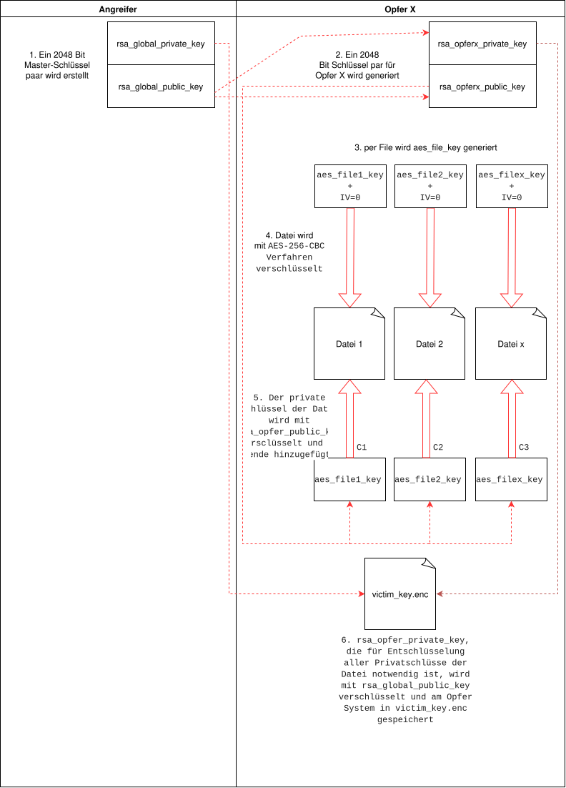
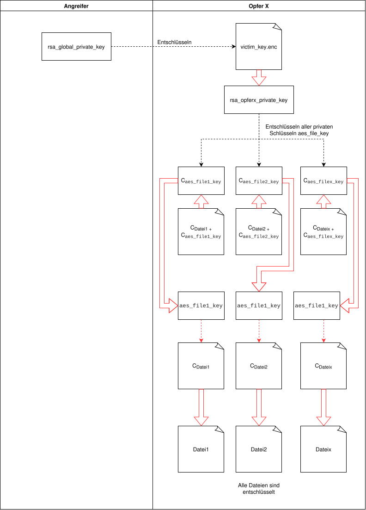

# Arbeitsbericht

- Name: Denis Ermurachi
- Datum: 05.10.2026
- Thema: Ryuk Ransomware
- Fach: SYTB
- Klasse: 4AHITS

---

#### Übung  1.1 (Ryuk Funktionsweise) 

__Skizze Verschlüsselung__

__Skizze Entschlüsselung__

#### Übung  1.2 (Ryuk – Red Team)

