# Arbeitsbericht

- Name: Denis Ermurachi
- Datum: 05.10.2026
- Laborübung: Übung_03-Standortvernetzung_IPv6
- Fach: SYTD
- Klasse: 4AHITS

---

1) Statische Routen:

    Am Router R-Br1 nu R-Sd1 werden folgende statische Routen benötigt, um die Kommunikation zwischen den beiden Standorten zu ermöglichen.
    
    ---

    R-Br1: 
    ```
        ipv6 route 2001:DB8:ACAD:3::/64 2001:DB8:ACAD:2::2
    ```

    ---

    R-Sd1:
    ```
        ipv6 route 2001:DB8:ACAD:1::/64 2001:DB8:ACAD:2::1
    ```

---

2) Konfigurationen:

    **PCs**

    | PC-A | PC-B |
    |-----|-------|
    | 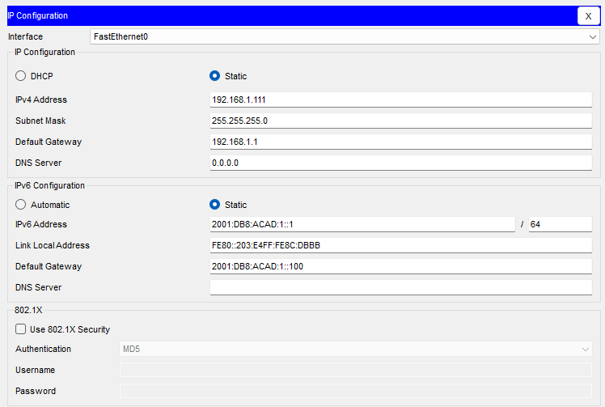 | 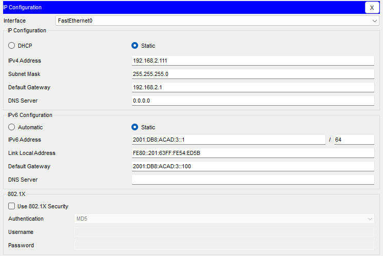 |

    ---

    **Switches**

    | | S-Br1 | S-Sd1 |
    |--|-----|-------|
    | Vlan1 Ipv6 | 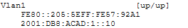 | 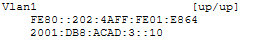 |
    | Vlan1 Interface | 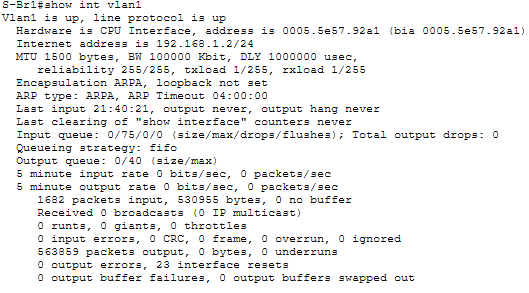 | 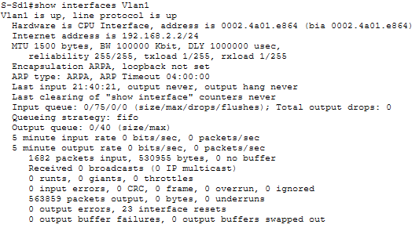 |

    ---

    **Routers**

    | | R-Br1 | R-Sd1 |
    |--|-----|-------|
    | Ipv6 Adressen | 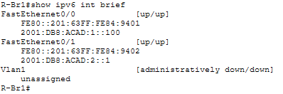 | 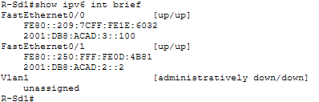 |
    | Interface FE0/0 | 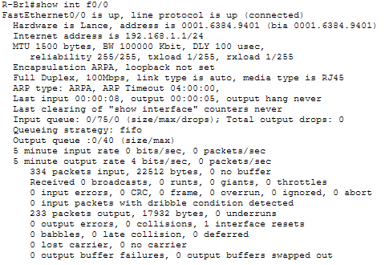 | 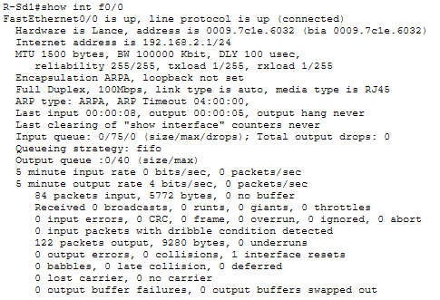 |
    | Interface FE0/1 | 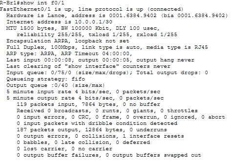 | 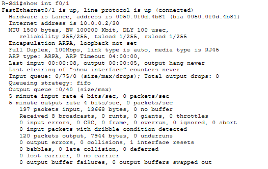 |
    | Routes | 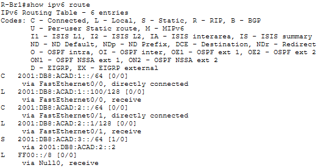 | 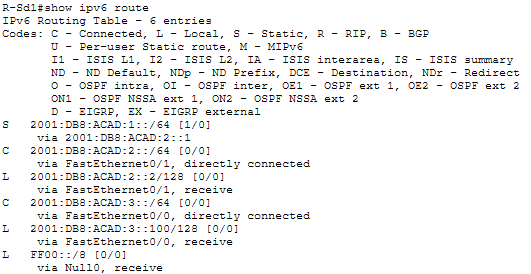 |

    ---

3) Konnektivitätstest:

    | von - zu | ipv6 | ipv4 |
    |---|---------|---------|
    | ```ping```<br> PC-A<br> ↓ <br>S-Br1 | 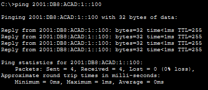 | 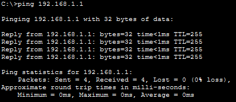 |
    | ```ping```<br> PC-A<br> ↓ <br>PC-B | 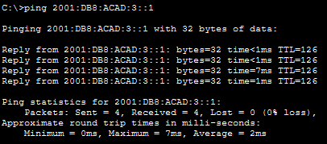 | 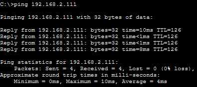 |
    | ```ping```<br> PC-B<br> ↓ <br>PC-A | 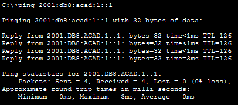 | 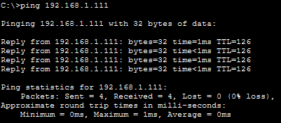 |
    | ```tracert```<br> PC-A<br> ↓ <br>S-Sd1 | 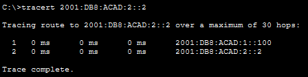 | 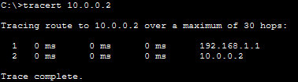 |
    | ```tracert```<br> PC-A<br> ↓ <br>PC-B | 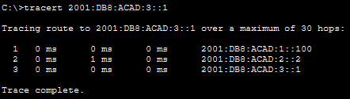 | 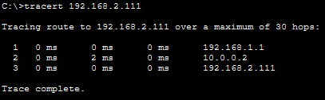 |
    | ```tracert```<br> PC-B<br> ↓ <br>PC-A | 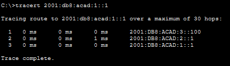 | 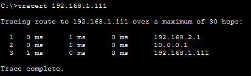 |